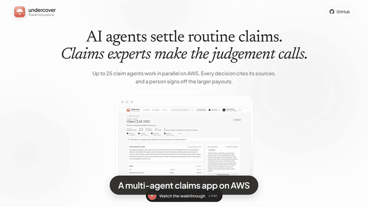

# travel-claims

**UnderCover: AI agents decide routine travel insurance claims in minutes, so handlers spend their time only on claims that need judgement.**

I designed and built UnderCover end to end to show AI engineering, security and cloud architecture working together. It has three apps for three audiences, a LangGraph claim agent and a handlers' Copilot, running on AWS with AgentCore and Bedrock. Every risk in the threat model has a control, every AWS resource is Terraform, and each control is a setting.

The idea and synthetic data come from [the UnderCover project](https://github.com/ed-donner/undercover) in Ed Donner's AI FDE course, which I recently completed after his [Proficient AI Engineer program](https://proficientaiengineer.com/certificate/c5032879-fe81-45d9-b460-68de7631bfda). The code, architecture and controls are my own.

[Architecture](#architecture) · [Security](#security) · [Walkthrough](#walkthrough) · [Quick start](#quick-start) · [Apps](#apps) · [Guides](#guides)

## Architecture

One design, the one a regulated insurer would run, with the platform team's controls assumed in place. Every step and control: [the AWS architecture guide](guides/03-aws-architecture.md).

## Security

1. **Prompt injection:** a hidden-instruction check and a Bedrock guardrail read every claim before any model does.
2. **Money never in a prompt:** code pays, after checking the approval limit and the pause switch; a payout can't run twice.
3. **Tool rules:** AgentCore Policy (Cedar) allows each gateway only its own tools.
4. **Checked answers:** grounding checks, Automated Reasoning against the policy wording, and letters filtered for personal numbers.
5. **Red team:** nine attacks mapped to the OWASP Top 10 for LLMs; an improvement is kept only if the red team still holds.
6. **Identity:** separate sign-ins per app, machine tokens between services, and GitHub to AWS over OIDC with no stored keys.
7. **Pipeline:** Gitleaks, Semgrep, CodeQL, Trivy and Checkov on every PR; images shipped with an SBOM; packages at least 7 days old.

Details: the [threat model](docs/threat-model.md), the [checklist](docs/checklist.md) and the [security trade-offs](guides/04-security-trade-offs.md) this prototype accepts.

## Walkthrough

The full three-minute walkthrough, with captions, plays on the project page ([the video](apps/home/media/walkthrough.mp4)).

## Quick start

Docker runs every app on a laptop to try it or test a change. AWS is deployed by the pipeline ([the runbook](guides/02-aws-runbook.md)).

1. Install Docker Desktop and [uv](https://docs.astral.sh/uv/), clone the repo and run `bash scripts/setup.sh`.
2. Copy `.env.example` to `.env` and add an Anthropic API key with its workspace ID.
3. Run `docker compose up --build -d` and open the project page at http://127.0.0.1:5172.
4. Sign in to an app with its test account (below), and make a claim with the [sample receipts](data/sample-receipts). `04-injection-test-mara-lodge.png` hides an instruction the hidden-instruction check should catch.
5. Browser tests, in [e2e](e2e): `npm ci` and `npx playwright install chromium` once, then `npm run stack`, `npm test` and `npm run stack:down`.
6. Start over: `docker compose down -v` (deletes the local database), then `up` again.

A claim costs 2 to 4 cents of Claude. Running costs: [costs.md](docs/costs.md).

## Apps

| App | For | Locally | Test account |
|---|---|---|---|
| `home` | Anyone: the project page | http://127.0.0.1:5172 | none |
| `portal` | Customers chat with Wattle to make, track and ask about claims | http://127.0.0.1:5173 | Oliver Grant: **Use test account** |
| `dashboard` | Handlers work the queue and sign off payouts | http://127.0.0.1:5174 | Dana Whitfield, senior: **Continue as Dana** |
| `console` | AI engineers: evals, live monitoring, red team | http://127.0.0.1:5175 | Sam Carter: **Continue as Sam** |

Behind them: `api` (claims, decisions, payments), `agent` (the claim agent), `copilot` (the handlers' Wattle AI) and `context` (policy lookups as an MCP server). Every feature: [features.md](docs/features.md).

**Built with:** Claude, LangGraph, MCP, FastAPI, PostgreSQL and Aurora DSQL, React and Vite, AgentCore, Bedrock, Textract, Terraform, GitHub Actions, Python 3.14 and uv, Playwright.

## Guides

1. [Findings](guides/01-findings.md): what the build found, and what was fixed.
2. [AWS runbook](guides/02-aws-runbook.md): deploy to `dev` and tear it down, step by step.
3. [AWS architecture](guides/03-aws-architecture.md): the design layer by layer, and where the platform team takes over.
4. [Security trade-offs](guides/04-security-trade-offs.md): the risks accepted, and the fix for production.

Developers start with [AGENTS.md](AGENTS.md), then [spec.md](docs/spec.md) and [TODO.md](TODO.md). To contribute: [CONTRIBUTING.md](CONTRIBUTING.md). To report a vulnerability: [SECURITY.md](SECURITY.md).
