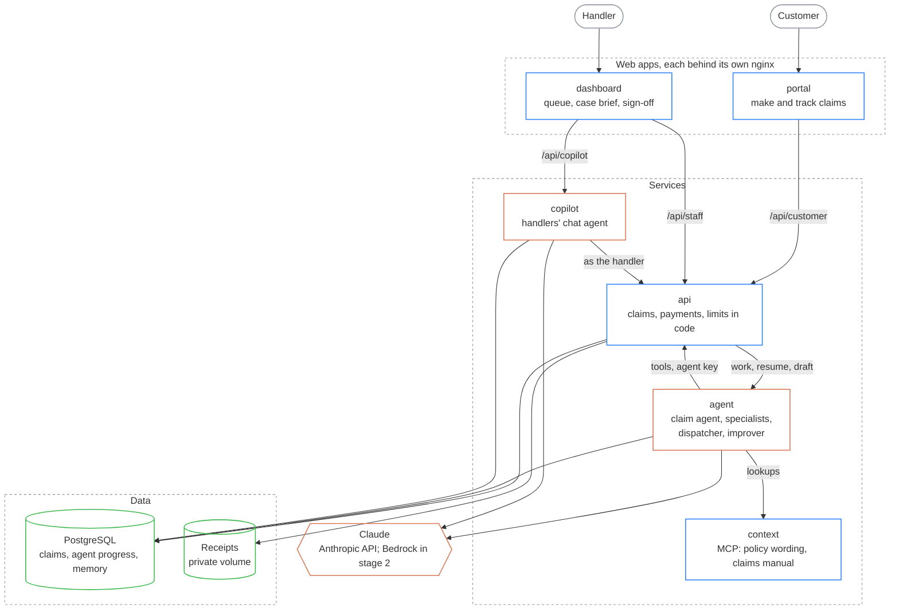

# travel-claims

**UnderCover: AI agents decide routine travel insurance claims in minutes, so handlers spend their time only on claims that need judgement.**

[Customers](#-customers) · [Handlers](#️-handlers) · [Apps](#-apps) · [Run it](#-run-it)

> Based on the UnderCover project from Ed Donner's AI FDE course ([ed-donner/undercover](https://github.com/ed-donner/undercover)), including its fictional sample data. Built with a secure agentic SDLC from [sdlc-template](https://github.com/euginevd/sdlc-template).

## 🧳 Customers

1. Sign in and start a claim: tap what happened, snap your receipts (JPEG, PNG or PDF), and an AI assistant drafts the claim for you to check.
2. Track it under **My claims**: **Received**, **Assessing**, **Decision**, then **Paid**.
3. Every decision says why in plain English. Not happy with it? Ask a person to review it.

## 🗂️ Handlers

1. The queue opens on **Needs me**: payouts waiting for sign-off, referrals and review requests first.
2. Open a claim for the case brief: the agent's recommendation, a checklist of what it verified with sources, and the payout worked out line by line. **Show trace** reveals every tool call, token and cost.
3. Sign off, send back or override. Approvals under $1,000 are paid automatically; anything over waits for a senior handler.
4. A senior handler can pause all payouts at once, run evaluations against human decisions, approve the agent's own improvements, and run the red-team suite. The **Copilot** answers questions and acts for the signed-in handler.

## 📦 Apps

Blue: apps · orange: AI agents and Claude · green: data. Trust boundaries and attacks: [threat-model.md](docs/threat-model.md).

| App | What | Runs on |
|-----|------|---------|
| `portal` | Customers make and track claims | Docker locally; EKS *(planned)* |
| `dashboard` | Handlers work the queue, sign off payouts and watch the agents | Docker locally; EKS *(planned)* |
| `api` | Claims, decisions, payments, settings and sign-in | Docker locally; EKS *(planned)* |
| `agent` | Claim agent with a hidden-instruction check and specialists, dispatcher, improver and drafting assistant | Docker locally; EKS *(planned)* |
| `copilot` | The handlers' chat agent | Docker locally; EKS *(planned)* |
| `context` | Policy wording, claims manual and reference data as an MCP server | Docker locally; EKS *(planned)* |

## 🚀 Run it

1. Install Docker Desktop and [uv](https://docs.astral.sh/uv/), then clone the repo.
2. Copy `.env.example` to `.env`, and add an Anthropic API key with its workspace ID.
3. `docker compose up --build -d`, then open the customer portal at http://127.0.0.1:5173 and the handlers' dashboard at http://127.0.0.1:5174. **Use test account** signs you in on each.

Developers: [AGENTS.md](AGENTS.md), then [docs/](docs/). Stages and what done means: [spec.md](docs/spec.md).
