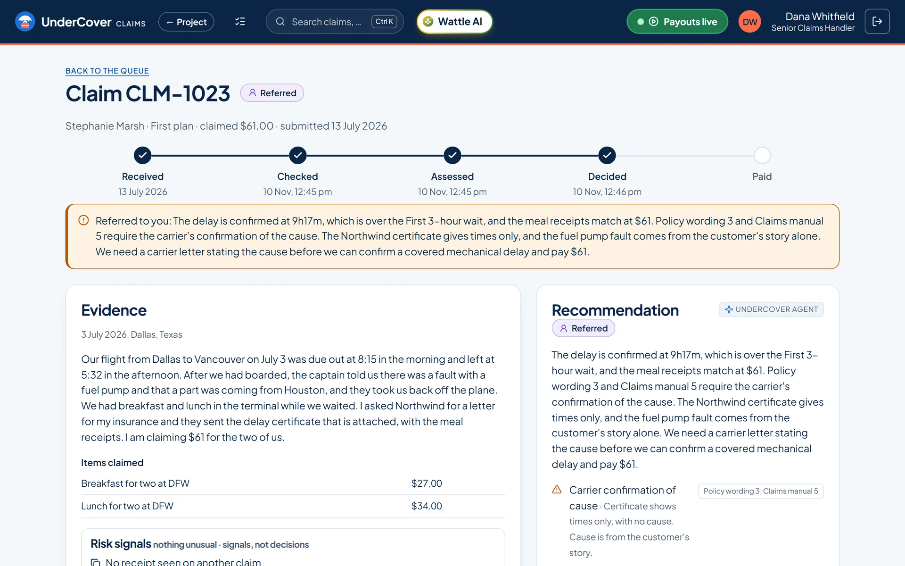
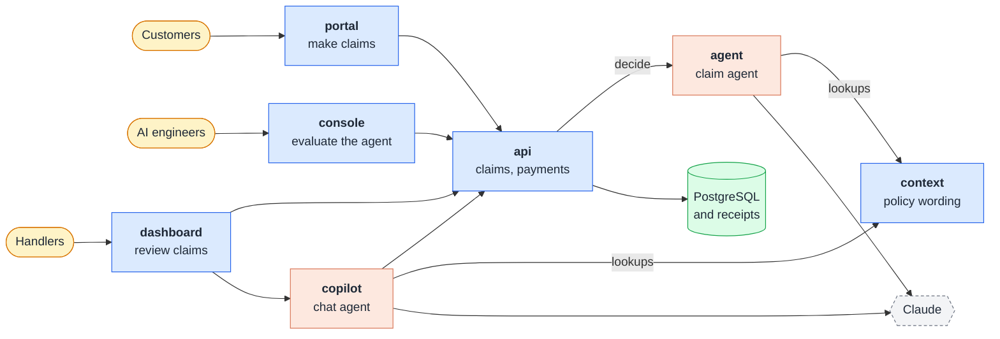

# travel-claims

**UnderCover: AI agents decide routine travel insurance claims in minutes, so handlers spend their time only on claims that need judgement.**

[Quick start](#quick-start) · [What you get](#what-you-get) · [Built with](#built-with) · [Guides](#guides)

 

The full walkthrough, three minutes with captions, plays on the project page ([the video](apps/home/media/walkthrough.mp4)).

> Based on the UnderCover project from Ed Donner's AI FDE course ([ed-donner/undercover](https://github.com/ed-donner/undercover)), including its fictional sample data. Built with a secure agentic SDLC from [sdlc-template](https://github.com/euginevd/sdlc-template).

## Quick start

1. Install Docker Desktop and [uv](https://docs.astral.sh/uv/), then clone the repo and run `bash scripts/setup.sh`.
2. Copy `.env.example` to `.env`, and add an Anthropic API key with its workspace ID.
3. `docker compose up --build -d`, then open the project page at http://127.0.0.1:5172: a short brief, the walkthrough video and a link to each app. Each app's sign-in page has a test account:

   | App | Address | Test account | Sign in with |
   |-----|---------|--------------|--------------|
   | Customer portal | http://127.0.0.1:5173 | Oliver Grant | **Use test account** |
   | Handlers' dashboard | http://127.0.0.1:5174 | Dana Whitfield, senior handler, or Marcus Oyelaran, who can't sign off | **Continue as Dana** |
   | AI assurance console | http://127.0.0.1:5175 | Sam Carter, AI engineer | **Continue as Sam** |
4. Make a claim with the sample receipts in [data/sample-receipts](data/sample-receipts): a delayed bag and a taxi in Nairobi, a clinic invoice in Sri Lanka, and `04-injection-test-mara-lodge.png`, which hides an instruction to the AI that the hidden-instruction check should catch.
5. Browser tests: in [e2e](e2e), `npm ci` and `npx playwright install chromium` once, then `npm run stack` (a second stack on every port plus 100), `npm test` and `npm run stack:down`. The other checks are in [AGENTS.md](AGENTS.md) → Commands.
6. Start over from a clean queue: `docker compose down -v`, then `up` again (this deletes the local database).

Each claim costs 2 to 4 cents of Claude. On AWS, the pipeline deploys the same apps (tiers below); what was added on 2026-11-11 runs locally and isn't deployed yet.

## What you get

| | |
|---|---|
| **Customers** | Make a claim in three steps (what happened, receipts, check what the AI drafted, your words stay the record); claim a delayed flight in one tap; follow it on a tracker with every email and text under **Updates**; get paid to your PayID; ask **Wattle AI** about your policy, with the wording cited; ask a person to review any decision; rate Wattle's answers and each decision's explanation |
| **Handlers** | The queue opens on what needs them; a case brief with the agent's recommendation, a checklist with sources and the payout line by line; approvals under the approval limit ($1,000 to start) pay automatically, larger ones wait for sign-off, send-back or an override with a reason; similar past claims and risk signals beside each claim; AI drafts the customer's letter; **Wattle AI** says what needs them, looks up the wording, and starts a dispatch, a send-back or a sign-off only after they confirm on a card; **Retry** carries on a claim the agent stopped working; a senior handler can pause every payout and change the limits under **Settings**, each change recorded |
| **AI engineers** | A separate assurance console: evaluations against handlers' decisions with a judge's grade, success criteria worked out in code, a **Live** page (straight through, how often handlers disagree, cost, customer feedback) whose disagreements can join the evaluation set, the improver's proposals kept only if they score better and the red team holds, and the red team's eight attacks mapped to the OWASP Top 10 for LLMs |
| **Security** | A hidden-instruction check and a Bedrock guardrail before any model reads a claim; payments and limits in code, never in a prompt; separate sign-ins and token audiences per app; a [threat model](docs/threat-model.md) with every control |

| App | What | Runs on (tier 2) |
|-----|------|------------------|
| `portal` | Customers make and track claims | S3 and CloudFront |
| `dashboard` | Handlers work the queue, ask customers for documents, sign off payouts and keep the settings | S3 and CloudFront |
| `console` | AI assurance: evaluations, live monitoring and improvements (quality), the red team and threat coverage (security) | S3 and CloudFront |
| `home` | The project page | S3 and CloudFront |
| `api` | Claims, decisions, payments, settings, feedback, live figures and sign-in | Lambda |
| `agent` | Claim agent with a hidden-instruction check and specialists, dispatcher, improver and drafting assistant | AgentCore Runtime |
| `copilot` | The handlers' chat agent, with confirm cards, a memory of each handler's preferences and each turn's cost | Lambda |
| `context` | Policy wording, claims manual and reference data as an MCP server | Lambda, behind AgentCore Gateway |

The same apps run two ways (decisions 14 and 29). Rough monthly cost in USD:

| Tier | Runs on | Status | Cost a month |
|------|---------|--------|-------------:|
| 1 · Local (Docker) | Docker Compose on a laptop, Claude through the Anthropic API | Built | Tokens only |
| 2 · AWS serverless, as built | S3 and CloudFront, Lambda, AgentCore (Runtime, Gateway, Memory), a Bedrock Knowledge Base and guardrail, Cognito, Supabase | Built, deployed and checked, then torn down to save cost | ≈ $10 (≈ $2 idle) |
| 2 · AWS serverless, secure target | The same, AWS-native: Aurora in Sydney, Claude on Bedrock only, private subnets, WAF, a multi-account landing zone | Planned: to build, then test | ≈ $100–200 before Claude |

The secure target adds control, not scale: tier 2 already scales ([infra/aws/README.md](infra/aws/README.md)). As built, tier 2 is mostly free tiers and pay-per-use, so it can stay up; Supabase's free project pauses after a week without use. Details: [costs.md](docs/costs.md).

## Built with

| Tool | What it does here | Where |
|------|-------------------|-------|
| Claude (Sonnet, Haiku) | Decides claims, checks for hidden instructions, drafts, answers questions | [apps/agent](apps/agent/), [apps/copilot](apps/copilot/) |
| LangGraph | The claim agent and the Copilot, with progress saved after every step | [apps/agent](apps/agent/) |
| MCP | The context layer's seven lookups, used by the claim agent and the Copilot | [apps/context](apps/context/) |
| FastAPI, PostgreSQL | The api, its rules and payments; Supabase on AWS | [apps/api](apps/api/) |
| React, Vite | The portal, dashboard and console | [apps/](apps/) |
| AgentCore | Runtime for the agent, Gateway in front of the context layer, Memory for customers | [infra/aws/agent](infra/aws/agent/) |
| Bedrock | The guardrail, the Knowledge Base on S3 Vectors, and Claude when `MODEL_PROVIDER` is `bedrock` | [infra/aws/agent](infra/aws/agent/), [infra/aws/guardrail](infra/aws/guardrail/) |
| Terraform | AWS infrastructure, one root per unit | [infra/aws/](infra/aws/) |
| GitHub Actions | App checks, security scans, images, Terraform plan and apply | [.github/workflows/](.github/workflows/) |
| Python, uv | Apps, scripts and one locked workspace | [pyproject.toml](pyproject.toml) |
| Semgrep, CodeQL | Static analysis | [security.yml](.github/workflows/security.yml), [codeql.yml](.github/workflows/codeql.yml) |
| Gitleaks | Secrets in code and history | [scan.sh](scripts/scan.sh) |
| Trivy, Checkov | Vulnerable packages, images and IaC misconfiguration | [security.yml](.github/workflows/security.yml) |
| Infracost | Cost of each Terraform change, as a PR comment | [aws.yml](.github/workflows/aws.yml) |
| Playwright | Browser tests across the apps | [e2e](e2e/) |
| Lefthook, Dependabot | The pre-push scan; weekly package updates | [lefthook.yml](lefthook.yml), [dependabot.yml](.github/dependabot.yml) |

## Guides

1. [Findings](guides/01-findings.md): what the build found, and what was fixed.
2. [Security trade-offs](guides/02-security-trade-offs.md): the risks this project accepts, and the fix for production.
3. [Cleaning up AWS](guides/03-aws-cleanup.md): remove everything from AWS so nothing is charged, prove it, and redeploy.

Developers start with [AGENTS.md](AGENTS.md), then [docs/](docs/): what's built is in [features.md](docs/features.md), what's next in [TODO.md](TODO.md), and what's left before real users in [checklist.md](docs/checklist.md); tiers and what done means are in [spec.md](docs/spec.md). To contribute, read [CONTRIBUTING.md](CONTRIBUTING.md); report vulnerabilities through [SECURITY.md](SECURITY.md).
