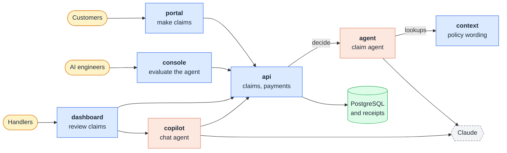

# travel-claims

**UnderCover: AI agents decide routine travel insurance claims in minutes, so handlers spend their time only on claims that need judgement.**

[Project](#-project-page) · [Customers](#-customers) · [Handlers](#️-handlers) · [AI engineers](#-ai-engineers) · [Apps](#-apps) · [Run it](#-run-it)

> Based on the UnderCover project from Ed Donner's AI FDE course ([ed-donner/undercover](https://github.com/ed-donner/undercover)), including its fictional sample data. Built with a secure agentic SDLC from [sdlc-template](https://github.com/euginevd/sdlc-template).

## 🧭 Project page

A local page at http://127.0.0.1:5172 that explains the project in two minutes: a card for each app with its test account and a live status dot, live numbers (claims decided by the agent alone, cost per claim, red-team attacks held), a five-minute script across the apps, a clickable architecture diagram and one claim's journey from portal to payment. No sign-in, no customer data, never deployed.

## 🧳 Customers

1. **Make a claim in three steps:** tap what happened, add photos or PDFs of your receipts, then check what an AI assistant drafted. Your words stay the record, and a half-finished claim is saved to finish later.
2. **Claim a delayed flight in one tap:** when the flight-status feed shows a flight on your trip was late enough for your plan, **My claims** offers it with nothing to fill in.
3. **Follow it:** a tracker (**Received**, **Assessing**, **Decision**, **Paid**), a list of anything we need from you with an upload for each, and every email and text under **Updates**.
4. **Get paid and get answers:** approved claims go to your PayID, and **Ask UnderCover** answers questions about your policy and claims, citing your policy wording. Every decision says why in plain English and when the AI helped, and you can ask a person to review it.

## 🗂️ Handlers

1. **Needs me first:** the queue opens on payouts waiting for sign-off, then referrals and customers' review requests.
2. **The case brief:** the agent's recommendation, a checklist of what it verified with sources, and the payout worked out line by line. Claims the hidden-instruction check stopped are flagged as screened.
3. **Decide:** approvals under $1,000 are paid automatically; sign off anything larger, send it back to the agent with a note, or override with a reason code. **Ask the customer** puts a request on their claim and emails and texts them. Once decided, AI drafts the customer's letter for the handler to edit and send.
4. **Help at hand:** search with Ctrl+K, and the **Copilot** answers questions and acts with the handler's own access. A senior handler can pause all payouts at once.

## 🧪 AI engineers

A separate **AI assurance console** with its own sign-in, apart from the handlers' workspace because it changes how the agent behaves.

1. **Quality:** score the agent against handlers' decisions on an evaluation set and a held-out set, and see any claim's model calls, tokens and cost.
2. **Improvement:** the improver proposes a better configuration as a diff; an AI engineer approves it, and it's kept only if it scores better on the held-out set and the red team can't get past it.
3. **Security:** the red-team suite attacks the agent with eight claims mapped to the OWASP Top 10 for LLMs and reports which attacks held.

## 📦 Apps

| App | What | Runs on |
|-----|------|---------|
| `portal` | Customers make and track claims | Docker locally; EKS *(planned)* |
| `dashboard` | Handlers work the queue, ask customers for documents and sign off payouts | Docker locally; EKS *(planned)* |
| `console` | AI assurance: evaluations and improvements (quality), the red team (security) | Docker locally; EKS *(planned)* |
| `home` | The local project page | Docker locally only |
| `api` | Claims, decisions, payments, settings and sign-in | Docker locally; EKS *(planned)* |
| `agent` | Claim agent with a hidden-instruction check and specialists, dispatcher, improver and drafting assistant | Docker locally; EKS *(planned)* |
| `copilot` | The handlers' chat agent | Docker locally; EKS *(planned)* |
| `context` | Policy wording, claims manual and reference data as an MCP server | Docker locally; EKS *(planned)* |

## 🚀 Run it

1. Install Docker Desktop and [uv](https://docs.astral.sh/uv/), then clone the repo.
2. Copy `.env.example` to `.env`, and add an Anthropic API key with its workspace ID.
3. `docker compose up --build -d`, then open the project page at http://127.0.0.1:5172. **Use test account** signs you in on each app:

   | App | Address | Test account |
   |-----|---------|--------------|
   | Customer portal | http://127.0.0.1:5173 | Oliver Grant |
   | Handlers' workspace | http://127.0.0.1:5174 | Dana Whitfield, senior handler |
   | AI assurance console | http://127.0.0.1:5175 | Sam Carter, AI engineer |
4. Make a claim with the sample receipts in [data/sample-receipts](data/sample-receipts): a delayed bag and a taxi in Nairobi, a clinic invoice in Sri Lanka, and `04-injection-test-mara-lodge.png`, which hides an instruction to the AI that the hidden-instruction check should catch.

Developers: [AGENTS.md](AGENTS.md), then [docs/](docs/). Stages and what done means: [spec.md](docs/spec.md).
