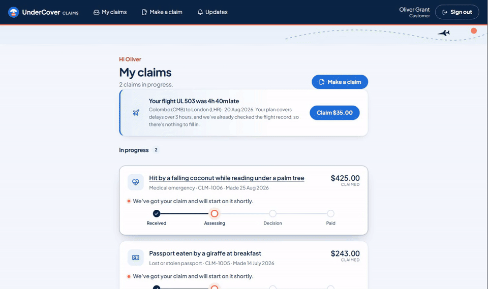

# travel-claims

**UnderCover: AI agents decide routine travel insurance claims in minutes, so handlers spend their time only on claims that need judgement.**

I designed and built UnderCover end to end to show AI engineering, security and cloud architecture working together: three apps for three audiences (a customer portal, a handlers' dashboard and an AI assurance console), a LangGraph claim agent and a handlers' Copilot, running on AWS with AgentCore and Bedrock. Every risk in the threat model has a control, guardrails check what goes into and comes out of the models, every AWS resource is Terraform, every change runs through GitHub Actions with OIDC and security scans, and it's one enterprise design where each control is a setting.

The idea and synthetic data come from [the UnderCover project](https://github.com/ed-donner/undercover) in Ed Donner's AI FDE course, which I recently completed after his [Proficient AI Engineer program](https://proficientaiengineer.com/certificate/c5032879-fe81-45d9-b460-68de7631bfda). The code, architecture and controls are my own.

[Architecture](#architecture) · [Security](#security-highlights) · [Walkthrough](#walkthrough) · [Quick start](#quick-start) · [What you get](#what-you-get) · [Built with](#built-with) · [Guides](#guides)

## Architecture

The full diagram, with each step and control: [the AWS architecture guide](guides/03-aws-architecture.md).

## Security highlights

The [threat model](docs/threat-model.md) names each risk and the control that answers it; the [security trade-offs](guides/04-security-trade-offs.md) list what this prototype accepts and the fix for production.

**AI security**
- **Prompt injection:** a hidden-instruction check and a Bedrock guardrail read every claim before any model does. The sample receipt `04-injection-test-mara-lodge.png` hides an instruction to prove it.
- **Output guardrails, failing closed:** Wattle AI's answers are checked for grounding against what its tools returned, and letters are filtered for card, bank, tax file and passport numbers.
- **Money never in a prompt:** the model can't reach a payment. Code pays after the api checks the approval limit and the pause switch, and a lost write race is refused, so a payout can't run twice.
- **Tool rules the model can't talk its way past:** AgentCore Policy (Cedar, enforced) allows each gateway only its own tools.
- **A red team** of eight attacks mapped to the OWASP Top 10 for LLMs; the improver's changes are kept only if they score better and the red team still holds.
- **Answers proven against the policy:** Automated Reasoning turns the policy wording into formal rules, and an answer they contradict is held back; one they prove says so to the customer.
- **Receipts read before any model sees them:** on AWS, Textract reads each receipt into fields, so the claim checks and the claim agent get text the guardrail can check, not an image; an unreadable receipt falls back to its image.
- **An audit trail:** Bedrock model invocation logging keeps each model call for 30 days in a bucket only the deploy role can delete from.

**Identity and access**
- Separate Cognito sign-ins and token audiences for customers, handlers and AI engineers; staff sign-in through the company's Okta (SAML) as reference code.
- Service to service: the agent calls the api with a machine token from AgentCore Identity, and the api then refuses the shared key. The context server has no URL at all; the gateways invoke it by its ARN.
- GitHub reaches AWS through OIDC, with no stored keys. Every role Terraform makes has its own narrow policy and a permissions boundary.

**Infrastructure**
- **One enterprise design, with every control a setting:** private subnets with VPC endpoints and DSQL over PrivateLink, API Gateway with its own WAF, the platform's KMS key, malware scanning of uploads, masking of personal data in logs, and online evaluations. The defaults are the low-cost options, so a demo costs under $10 a month idle.
- **A clear platform boundary:** the network, keys and backups belong to the platform team and are read through SSM parameters, the same contract a real landing zone publishes.

**Pipeline and supply chain**
- Gitleaks, Semgrep, CodeQL, Trivy and Checkov on every push and PR; each image scanned and shipped with its SBOM.
- Packages pinned and locked, never newer than 7 days; Dependabot weekly.
- Terraform planned on each PR with an Infracost comment, and applied only from `main`.

## Walkthrough

The full walkthrough, three minutes with captions, plays on the project page ([the video](apps/home/media/walkthrough.mp4)).

## Quick start

Docker runs every app on a laptop, to try it or test a change before deploying to AWS ([the runbook](guides/02-aws-runbook.md)).

1. Install Docker Desktop and [uv](https://docs.astral.sh/uv/), then clone the repo and run `bash scripts/setup.sh`.
2. Copy `.env.example` to `.env`, and add an Anthropic API key with its workspace ID.
3. `docker compose up --build -d`, then open the project page at http://127.0.0.1:5172: a short brief, the walkthrough video and a link to each app. Each app's sign-in page has a test account:

   | App | Address | Test account | Sign in with |
   |-----|---------|--------------|--------------|
   | Customer portal | http://127.0.0.1:5173 | Oliver Grant | **Use test account** |
   | Handlers' dashboard | http://127.0.0.1:5174 | Dana Whitfield, senior handler, or Marcus Oyelaran, who can't sign off | **Continue as Dana** |
   | AI assurance console | http://127.0.0.1:5175 | Sam Carter, AI engineer | **Continue as Sam** |
4. Make a claim with the sample receipts in [data/sample-receipts](data/sample-receipts): a delayed bag and a taxi in Nairobi, a clinic invoice in Sri Lanka, and `04-injection-test-mara-lodge.png`, which hides an instruction to the AI that the hidden-instruction check should catch.
5. Browser tests: in [e2e](e2e), `npm ci` and `npx playwright install chromium` once, then `npm run stack` (a second stack on every port plus 100), `npm test` and `npm run stack:down`. The other checks are in [AGENTS.md](AGENTS.md) → Commands.
6. Start over from a clean queue: `docker compose down -v`, then `up` again (this deletes the local database).

Each claim costs 2 to 4 cents of Claude. Docker is for testing locally; the design is the AWS build below, which the pipeline deploys. The AWS build is torn down between demos.

## What you get

| | |
|---|---|
| **Customers** | Make a claim in three steps (what happened, receipts, check what the AI drafted, your words stay the record); claim a delayed flight in one tap; follow it on a tracker with every email and text under **Updates**; get paid to your PayID; ask **Wattle AI** about your policy, with the wording cited; ask a person to review any decision; rate Wattle's answers and each decision's explanation |
| **Handlers** | The queue opens on what needs them; a case brief with the agent's recommendation, a checklist with sources and the payout line by line; approvals under the approval limit ($1,000 to start) pay automatically, larger ones wait for sign-off, send-back or an override with a reason; similar past claims and risk signals beside each claim; AI drafts the customer's letter; **Wattle AI** says what needs them, looks up the wording, and starts a dispatch, a send-back or a sign-off only after they confirm on a card; **Retry** carries on a claim the agent stopped working; a senior handler can pause every payout and change the limits under **Settings**, each change recorded |
| **AI engineers** | A separate assurance console: evaluations against handlers' decisions with a judge's grade, success criteria worked out in code, a **Live** page (straight through, how often handlers disagree, cost, customer feedback) whose disagreements can join the evaluation set, the improver's proposals kept only if they score better and the red team holds, and the red team's eight attacks mapped to the OWASP Top 10 for LLMs |
| **Security** | A hidden-instruction check and a Bedrock guardrail before any model reads a claim; payments and limits in code, never in a prompt; separate sign-ins and token audiences per app; a [threat model](docs/threat-model.md) with every control |

## Apps and cost

| App | What | Runs on (AWS) |
|-----|------|---------------|
| `portal` | Customers make and track claims | S3 and CloudFront |
| `dashboard` | Handlers work the queue, ask customers for documents, sign off payouts and keep the settings | S3 and CloudFront |
| `console` | AI assurance: evaluations, live monitoring and improvements (quality), the red team and threat coverage (security) | S3 and CloudFront |
| `home` | The project page | S3 and CloudFront |
| `api` | Claims, decisions, payments, settings, feedback, live figures and sign-in | Lambda |
| `agent` | Claim agent with a hidden-instruction check and specialists, dispatcher, improver and drafting assistant | AgentCore Runtime |
| `copilot` | The handlers' chat agent, with confirm cards, a memory of each handler's preferences and each turn's cost | Lambda |
| `context` | Policy wording, claims manual and reference data as an MCP server | Lambda, behind AgentCore Gateway |

One design, the one a regulated insurer would run, with its platform team's controls assumed in place (decision 37): S3 and CloudFront with WAF, Lambda and AgentCore (Runtime, Gateway with Policy, Memory, Identity, Observability, Evaluations) in private subnets behind VPC endpoints, a Bedrock Knowledge Base and guardrails on what goes in and what comes out, Claude on Bedrock or the Anthropic API, Cognito, Aurora DSQL through its own endpoint and backed up daily, and DynamoDB, all in Sydney. Every piece is managed and scales on its own. The [AWS architecture](guides/03-aws-architecture.md) walks through it end to end.

Rough monthly cost in USD:

| Setup | Cost a month, plus Claude tokens |
|-------|------:|
| Default: no VPC, API Gateway or online evaluations | under $10 |
| Full design: private network, API Gateway, evaluations ([settings](guides/03-aws-architecture.md#settings)) | $165 to $220 while up |
| Local: Docker Compose | $0 |

Details: [costs.md](docs/costs.md).

## Built with

| Tool | What it does here | Where |
|------|-------------------|-------|
| Claude (Sonnet, Haiku) | Decides claims, checks for hidden instructions, drafts, answers questions | [apps/agent](apps/agent/), [apps/copilot](apps/copilot/) |
| LangGraph | The claim agent and the Copilot, with progress saved after every step | [apps/agent](apps/agent/) |
| MCP | The context layer's seven lookups, used by the claim agent and the Copilot | [apps/context](apps/context/) |
| FastAPI, PostgreSQL | The api, its rules and payments; Aurora DSQL on AWS | [apps/api](apps/api/) |
| React, Vite | The portal, dashboard and console | [apps/](apps/) |
| AgentCore | Runtime for the agent, Gateway in front of the context layer, Memory for customers | [infra/aws/agent](infra/aws/agent/) |
| Bedrock, Textract | The guardrails with Automated Reasoning checks, the Knowledge Base on S3 Vectors, Textract reading receipts, and Claude when `MODEL_PROVIDER` is `bedrock` | [infra/aws/agent](infra/aws/agent/), [infra/aws/guardrail](infra/aws/guardrail/) |
| Terraform | AWS infrastructure, one root per unit | [infra/aws/](infra/aws/) |
| GitHub Actions | App checks, security scans, images, Terraform plan and apply | [.github/workflows/](.github/workflows/) |
| Python, uv | Apps, scripts and one locked workspace | [pyproject.toml](pyproject.toml) |
| Semgrep, CodeQL | Static analysis | [security.yml](.github/workflows/security.yml), [codeql.yml](.github/workflows/codeql.yml) |
| Gitleaks | Secrets in code and history | [scan.sh](scripts/scan.sh) |
| Trivy, Checkov | Vulnerable packages, images and IaC misconfiguration | [security.yml](.github/workflows/security.yml) |
| Infracost | Cost of each Terraform change, as a PR comment | [aws.yml](.github/workflows/aws.yml) |
| Playwright | Browser tests across the apps | [e2e](e2e/) |
| Lefthook, Dependabot | The pre-push scan; weekly package updates | [lefthook.yml](lefthook.yml), [dependabot.yml](.github/dependabot.yml) |

## Guides

1. [Findings](guides/01-findings.md): what the build found, and what was fixed.
2. [Deploying to AWS, and tearing it down](guides/02-aws-runbook.md): from nothing to running in `dev`, and back to nothing, step by step.
3. [AWS architecture](guides/03-aws-architecture.md): the design end to end, layer by layer, and where the platform team's controls take over.
4. [Security trade-offs](guides/04-security-trade-offs.md): the risks this project accepts, and the fix for production.

Developers start with [AGENTS.md](AGENTS.md), then [docs/](docs/): what's built is in [features.md](docs/features.md), what's next in [TODO.md](TODO.md), and what's left before real users in [checklist.md](docs/checklist.md); where it runs and what done means are in [spec.md](docs/spec.md). To contribute, read [CONTRIBUTING.md](CONTRIBUTING.md); report vulnerabilities through [SECURITY.md](SECURITY.md).
