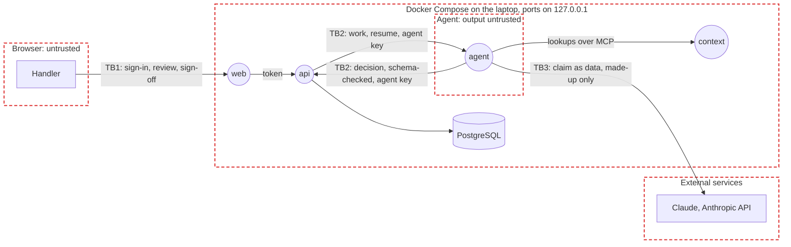

# Threat model

UnderCover in stage 1, on a laptop with made-up data; extended for AWS in stage 2. STRIDE on the data flow below; each risk maps to the OWASP lists that fit the app: Top 10:2025 (A), API Security Top 10:2023 (API), LLM Top 10:2025 (LLM) and Agentic Top 10:2026 (ASI).

## Data flow

Rectangles are external entities, circles processes, cylinders data stores, red dashed boxes trust boundaries; TB labels mark the flows that cross a boundary. In stage 2 the laptop becomes the AWS account in `ap-southeast-2`, sign-in moves to Amazon Cognito, and Claude moves to Bedrock's Australian inference profile.

| ID | Data | Class | Where |
|:-:|------|-------|-------|
| D1 | Customers' names, contact details, travel and medical details in claims | Highly sensitive in production; made up in stage 1 | PostgreSQL |
| D2 | Decisions, their reasons, calculations and payments | Confidential | PostgreSQL |
| D3 | Policy wording, claims manual and the other context files | Internal | The context layer, read by the agent |
| D4 | Handlers' decisions on the labelled sets: the answer key | Confidential | `data/evals/`, never loaded where the agent can reach it |
| D5 | The Anthropic key, the agent's key and the sign-in signing key | Secret | `.env` and memory, never logged |

## Trust boundaries

- **TB1** Browser to the app: handlers sign in (a Cognito-shaped local stand-in, Cognito in stage 2); everything the browser sends is untrusted.
- **TB2** Agent and `api`: model output is untrusted; the `api` checks every decision against claims manual section 14 and the payout calculation before it can drive a payment.
- **TB3** App to Claude: claim text leaves the laptop. Stage 1 sends only made-up data (spec 35); stage 2 keeps it in Australia.

## Top risks

STRIDE: Spoofing, Tampering, Repudiation, Information disclosure, Denial of service, Elevation of privilege.

| ID | Risk | STRIDE | OWASP | Rating | Controls | Enforced at |
|:-:|------|:------:|-------|:------:|----------|-------------|
| R1 | Instructions hidden in a claim make the agent approve or pay it | T, E | LLM01, ASI01 | High | The hidden-instruction check on a separate model before the claim agent sees the claim (spec 23), content kept apart from instructions (code-standards 18), limits in code (spec 29); CLM-1901 test | Code, Test |
| R2 | The agent pays more than allowed, or pays twice | T, E | LLM06, ASI02 | High | The payments module checks the limit before reading the claim and fails closed (code-standards 7); sign-off over $1,000 (spec 21); one payment per claim enforced by the database (spec 24) | Code, Test |
| R3 | The agent reads or acts on another customer's claim or memory | I, E | A01, API1, LLM02 | High | Tools take the claim and customer from the agent's context, not the model (spec 32); abuse-case tests (code-standards 11) | Code, Test |
| R4 | The agent's key acts as a handler, or a handler without the right signs off | S, E | A01, API5 | High | One gate per route, deny by default (code-standards 10); the key never stands in for a handler (spec 31); per-route tests | Code, Test |
| R5 | The local sign-in stand-in runs outside the laptop | S | A07 | High | The `api` refuses to start with it on unless `ENVIRONMENT=local`; tokens need `email_verified` | Code, Deploy |
| R6 | A decision can't be traced to who or what made it | R | A09 | Medium | The server records the maker, the time and the manual's version on every decision (spec 20) | Code |
| R7 | Personal data leaks into logs | I | A09, LLM02 | Medium | Redaction at the source, SQL parameters hidden, every logger through one formatter (code-standards 8, spec 34) | Code, Test |
| R8 | Claim data leaves for a model provider overseas | I | LLM02 | Medium | Made-up data only in stage 1 (spec 35); Bedrock's Australian profile in stage 2 | Deploy |
| R9 | Runaway model calls run up the bill | D | LLM10, API4 | Medium | Model call limits and timeouts (code-standards 19), the workspace's spend limit, each round's spending limit (spec 26) | Code, Operate |
| R10 | A bad configuration from the improver *(planned)* | T, E | ASI07 | Medium | A senior handler approves every proposal; keep or roll back on the held-out set; the improver can't change limits, models or evaluation sets (spec 26) | Code, Test |
| R11 | The Copilot signs off without the handler *(planned)* | E | ASI02, ASI03 | Medium | It acts with the handler's own sign-in and pays only after the handler confirms on a card (spec 27, 31) | Code, Test |
| R12 | A compromised package or image | T | A03, LLM03 | Medium | Exact pins resolved a week back, images pinned by digest, Trivy on every push and PR | Code, Build |
| R13 | A secret is committed | I | A07 | Medium | `.env` ignored and kept out of images, the pre-push scan, OIDC with no long-lived keys in stage 2 | Code, Deploy |

## Compliance

- Stage 1 sends only made-up data to the Anthropic API (spec 35). Before stage 2 uses real-looking data: a privacy impact assessment, including the Privacy Act's automated decision rules from 10 December 2026 (business 3).
- APRA CPS 234 and CPS 230 controls are designed in for stage 2: controls tested yearly, APRA told within 72 hours of a material security incident, suspected breaches assessed within 30 days.
