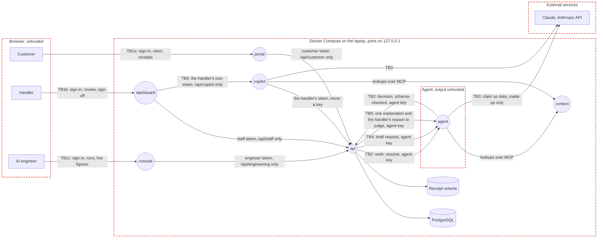

# Threat model

UnderCover on AWS, the design, with made-up data; locally, Docker runs the same apps on a laptop to test them. STRIDE on the data flow below; each risk maps to the OWASP lists that fit the app: Top 10:2025 (A), API Security Top 10:2023 (API), LLM Top 10:2025 (LLM) and Agentic Top 10:2026 (ASI).

## Data flow

Rectangles are external entities, circles processes, cylinders data stores, red dashed boxes trust boundaries; TB labels mark the flows that cross a boundary. On AWS the laptop becomes the AWS account in `ap-southeast-2` (serverless, decision 13), the functions, the agent's runtime and the lookup programs run in private subnets that reach AWS through VPC endpoints and leave only through the platform's egress (decision 36), PostgreSQL moves to Aurora DSQL in Sydney (IAM sign-in, no password) and the agent's checkpoints to DynamoDB, sign-in moves to Amazon Cognito, Claude moves to Bedrock's Australian inference profile only, and with `CLOUDFRONT_WAF=on` the sites sit behind the platform's Firewall Manager WAF policy (off in this prototype, decision 51). On AWS the agent reaches the context layer through AgentCore Gateway: the agent's role may call only that gateway, the context has no URL and only the gateway's role may invoke it, and AgentCore Policy allows each tool call (decision 34). The agent's customer memory is AgentCore Memory, and Ask UnderCover searches the policy wording in a Bedrock Knowledge Base on S3 Vectors (the public wording only, one document per section).

| ID | Data | Class | Where |
|:-:|------|-------|-------|
| D1 | Customers' names, contact details, travel and medical details in claims | Highly sensitive in production; made up here | PostgreSQL |
| D2 | Decisions, their reasons, calculations and payments | Confidential | PostgreSQL |
| D3 | Policy wording, claims manual and the other context files | Internal | The context layer, read by the agent |
| D4 | Handlers' decisions on the labelled sets: the answer key, plus live claims an engineer added with the handler's final decision (a second copy of that claim's story and items) | Confidential | `data/evals/` and the api's `labelled_claims`; no route the agent can call returns one, and the api sends the judge one handler's reason at a time, which it keeps and logs nowhere (TB5) |
| D6 | Receipts: images and PDFs customers upload | Highly sensitive in production; made up here | The receipt volume (an S3 bucket on AWS), under random names |
| D7 | Customers' feedback: a vote, and up to 300 characters each of comment and question | Sensitive in production (free text); made up here | PostgreSQL (`feedback`); engineers see it without a name or customer id; never sent to a model |
| D8 | The Copilot's conversations and each handler's remembered preferences | Internal | PostgreSQL (`copilot` schema), one handler's only |
| D9 | Settings and their change history: the approval limit, spending limit and objectives | Confidential | PostgreSQL (`settings`, `setting_changes`) |
| D5 | The Anthropic key, the agent's key and the two sign-in signing keys | Secret | `.env` and memory, never logged; on AWS the Anthropic key and both machine clients' secrets stay in AgentCore Identity's token vault (the clients' secrets also in the identity unit's Terraform state, trade-off 14), and the agent's key is refused (decision 38) |

## Trust boundaries

- **TB1a** Customers to the portal: customers sign in through the customer issuer (a Cognito-shaped local stand-in; a Cognito user pool, email and password only, on AWS, whose public test-account button signs anyone in as Oliver Grant, made-up data only). The portal's web server forwards only `/api/customer/`; everything the browser sends is untrusted, receipts included.
- **TB1b** Staff to the dashboard: handlers sign in through a separate staff issuer, with its own signing key and audience (a separate Cognito user pool on AWS, reachable only from allowed networks). The dashboard's web server forwards only `/api/staff/`.
- **TB1c** AI engineers to the console: a third issuer, signing key and audience; the console's web server forwards only `/api/engineering/`. An engineer's one write into the evaluation set (a live claim a handler overrode) is insert-only and recorded (R29).
- **TB6** The Copilot: the dashboard sends each question with the handler's own token, which the Copilot checks with the `api` and never saves; every tool is a staff route the `api` authorises again, and a sign-off, send-back or dispatch waits on a confirm card (R11, R28). What it reads from a claim is customer data, never instructions.
- **TB2** Agent and `api`: model output is untrusted; the `api` checks every decision against claims manual section 14 and the payout calculation before it can drive a payment.
- **TB3** App to Claude: claim text leaves the laptop. Only made-up data is sent (spec 26); on Bedrock it stays in Australia.
- **TB5** The judge: after an evaluation, the api sends the agent service's judge (Claude Haiku) one copy at a time: the agent's decision, reason and section beside the handler's. The agent's reason is untrusted model output; the judge's grade comes back to the api, which validates and stores it. The claim agent and the improver never receive the pairs (spec 24).
- **TB4** The drafting assistant: a customer's words and receipts go to Claude Haiku through the agent service, and its draft comes back to the customer's browser. The draft is untrusted model output: the `api` validates it, the customer confirms or fixes every field, it is never submitted for them, and the claim agent reads the customer's own words as the record (features 3). On AWS an output guardrail also filters personal data from letters and checks Ask UnderCover's answers are grounded in the wording, failing closed (decision 38).

## Top risks

STRIDE: Spoofing, Tampering, Repudiation, Information disclosure, Denial of service, Elevation of privilege.

| ID | Risk | STRIDE | OWASP | Rating | Controls | Enforced at |
|:-:|------|:------:|-------|:------:|----------|-------------|
| R1 | Instructions hidden in a claim make the agent approve or pay it | T, E | LLM01, ASI01 | High | On AWS a Bedrock guardrail on the customer's text, failing closed, so an outage refers every claim; the hidden-instruction check on a separate model before the claim agent sees the claim (spec 21), and on AWS receipts reach the models as Textract's fields, which the guardrail checks too, never as images (decision 48), content kept apart from instructions (code-standards 18), limits in code (spec 20); CLM-1901 test | Code, Test |
| R2 | The agent pays more than allowed, or pays twice | T, E | LLM06, ASI02 | High | The payments module checks the limit before reading the claim and fails closed (code-standards 7); sign-off over $1,000 (features 13); one payment per claim enforced by the database (features 13) | Code, Test |
| R3 | The agent reads or acts on another customer's claim or memory | I, E | A01, API1, LLM02 | High | Tools take the claim and customer from the agent's context, not the model (spec 23); abuse-case tests (code-standards 11) | Code, Test |
| R4 | The agent's key acts as a handler, or a handler without the right signs off | S, E | A01, API5 | High | One gate per route, deny by default (code-standards 10); the key never stands in for a handler (spec 22); per-route tests; on AWS the agent calls the api with its own machine token, never the shared key (decision 38) | Code, Test |
| R5 | The local sign-in stand-in runs outside the laptop | S | A07 | High | The `api` refuses to start with it on unless `ENVIRONMENT=local`; tokens need `email_verified` | Code, Deploy |
| R6 | A decision can't be traced to who or what made it | R | A09 | Medium | The server records the maker, the time and the manual's version on every decision (spec 25) | Code |
| R7 | Personal data leaks into logs | I | A09, LLM02 | Medium | Redaction at the source, SQL parameters hidden, every logger through one formatter (code-standards 8, spec 25) | Code, Test |
| R8 | Claim data leaves for a model provider overseas | I | LLM02 | Medium | Made-up data only, locally and on AWS alike (spec 26, decisions 15 and 31); the API key only in the app settings, from a GitHub secret; Bedrock's Australian profile with `MODEL_PROVIDER=bedrock` | Deploy, Code |
| R9 | Runaway model calls run up the bill | D | LLM10, API4 | Medium | Model call limits and timeouts (code-standards 19), the workspace's spend limit, each round's spending limit (features 25) | Code, Operate |
| R10 | A bad configuration from the improver *(planned)* | T, E | ASI07 | Medium | An AI engineer approves every proposal; keep or roll back on the held-out set; the improver can't change limits, models or evaluation sets (features 25) | Code, Test |
| R11 | The Copilot signs off without the handler | E | ASI02, ASI03 | Medium | It acts with the handler's own sign-in (never a service key; the token stays out of checkpoints) and pays only after the handler confirms on a card (features 20, spec 22); conversations are each handler's own | Code, Test |
| R12 | A compromised package or image | T | A03, LLM03 | Medium | Exact pins resolved a week back, images pinned by digest, Trivy on every push and PR | Code, Build |
| R13 | A secret is committed | I | A07 | Medium | `.env` ignored and kept out of images, the pre-push scan, OIDC with no long-lived keys on AWS | Code, Deploy |
| R14 | A customer reaches another customer's claim, policy or receipt, or a customer token reaches handler routes | I, E | A01, API1, API5 | High | Separate apps and issuers for staff and customers (decision 10): `/api/staff/*` verifies only the staff issuer's key and audience, so a customer token fails the signature before any role check; each web server forwards only its own prefix; the Cognito group is checked too; every customer query filters on the signed-in customer; abuse-case tests on every route both ways (spec 21). In the AWS demo, `TEST_SIGN_IN` lets anyone sign in as the test customers, Oliver and the red team's Derek (made-up data only, each seeing only their own), and a sign-in resets that account's password, so a red-team run can be disturbed; it's off outside the demo | Code, Test, Deploy |
| R15 | A malicious receipt file attacks the app or a handler's browser | T, E | A03, A08 | Medium | Type from magic bytes (JPEG, PNG, PDF only), 5 MB and five-file limits, random stored names, downloads as attachments with `nosniff`, never on a public URL (spec 21) | Code, Test |
| R16 | Instructions hidden in a receipt make the agent approve or pay | T, E | LLM01, ASI01 | High | The hidden-instruction check reads every receipt before the claim agent (the Bedrock guardrail screens the claim's text only, not receipt images or PDFs); receipts delimited as customer-supplied data; limits in code (spec 20, 21) | Code, Test |
| R17 | The drafting assistant inflates amounts or slips instructions into the claim | T | LLM01, LLM05, LLM09 | Medium | The draft is validated against a schema with amount limits, tagged by source, highlighted where unsure and confirmed by the customer; the claim agent reads the customer's own words; the hidden-instruction check still screens the submitted claim and receipts; the payout is worked out in code from the policy | Code, Test |
| R18 | A customer runs up model costs through the drafting assistant | D | LLM10, API4 | Low | Ten drafts an hour per customer, a token cap per draft, the workspace spend limit | Code, Operate |
| R19 | A senior handler's override pays without a record of why | R | A09 | Medium | Override needs a reason code and note; the record keeps the agent's decision, who overrode it and when; nothing already paid can change | Code, Test |
| R20 | A poisoned memory: a customer's earlier claim steers a later decision | T | ASI06, LLM04 | Medium | Memory holds only the claim's facts and the agent's decision, never the customer's words; nothing from a claim the check referred or an evaluation; one namespace per customer; the claim history in the records still counts (spec 23). On AWS the records are AgentCore Memory's, written by the agent's own code with no extraction strategy, so no model reads the customer's words into memory |  Code, Test |
| R21 | Money keeps leaving during an incident | T, E | LLM06, ASI02 | High | The payouts kill switch: a senior handler pauses every payment, the payments module refuses first and fails closed, approvals hold, and every change is audited (features 17) | Code, Operate |
| R22 | A new attack slips past the defences unnoticed | T | LLM01, ASI01 | Medium | The red-team suite (features 29) runs attack claims end to end and must end with nothing paid beyond what each claim supports; the latest report is in the AI assurance console; on AWS the console starts it in the agent, signing in as its own attacker customer through Cognito, so it tests the deployed defences | Test |
| R23 | Retrying a stalled claim starts the same work twice, deciding or paying it twice | T | LLM06, ASI02 | Medium | A retry claims the stalled claim with a compare-and-set on its heartbeat, so only one retry starts; the agent refuses a claim it is already working; one decision per attempt and one payment per claim in the database (R2); automatic recovery capped at 2 a claim; the dev-only stall route only when `ENVIRONMENT=local` (R5) | Code, Test |
| R24 | A receipt's hidden instruction steers a lookup program the model writes, to send out the claim and customer the model has read, or to run up cost *(off: `CODE_EXECUTION`)* | I, D | LLM01, LLM05, ASI05 | High | Off by default, and nothing (interpreter, role or permission) exists while off. On the private network the interpreter runs in VPC mode with a security group that reaches only the VPC endpoints, so a program can't reach the internet (decision 36); with `NETWORK_MODE=public` its network lets a program send anything to any host, so keep it off there. Meanwhile: the hidden-instruction check and the guardrail run first; the interpreter's role may call only the context gateway (public policy data); the claim's own tools and every decision stay outside the sandbox (R3, decision 4); a 60-second wait, 4,000 characters in and 8,000 out; every program and its output recorded as a step | Code, Deploy |
| R25 | A dispatch runs up the bill, or works a claim twice beside a handler's Work this claim or a retry | D, T | LLM10, API4, ASI02 | Medium | Only a senior handler starts one (decision 7's signers); one dispatch or evaluation run at a time; it takes only claims waiting when it starts, at most 25 agents at once; each claim is started with the existing compare-and-set (`start_claim` refuses one that isn't waiting), so a handler's start or a retry and the dispatch start it once; one decision per attempt and one payment per claim (R2); the kill switch still holds every approval (R21); its cost recorded per claim | Code, Test |
| R26 | The judge is steered or leaks the answer key: hidden instructions carried into the agent's reason inflate its grade, or a held-out reason reaches the improver | T, I | LLM01, LLM02, ASI06 | Low | The grade is shown only, never in the keep-or-roll-back rule, a payment or a decision; the judge sees the two reasons and sections as delimited data, not the claim, and answers in a schema the api validates (0 to 3, two booleans, a 200-character note); the pairs go only to `/judge`, never into a checkpoint, a step, memory or a log; the improver reads only evaluation-set misses, and of earlier rounds only what was tried and whether it was kept, never a held-out score or reason (decision 49) | Code, Test |
| R27 | A senior handler raises the approval limit so the agent pays larger claims without a person | E, T | LLM06, API5, ASI03 | Medium | Only a senior handler changes it, within a fixed $100 to $5,000 range; every change is kept with who, when, old, new and reason; a held payout stays held and a paid claim never changes; the success criteria judge each payment against the limit on its own decision | Code |
| R28 | The Copilot is talked into starting a dispatch, sending a claim back, or remembering claim text as a preference | T, E | LLM01, LLM06, ASI02 | Medium | Dispatch and send-back wait on a confirm card like a sign-off, and a sign-off answer can't confirm another action; the api enforces the handler's role; memory is per handler from the verified token, 20 notes of 300 characters, each save shown on a card, with forget-all | Code |
| R29 | A customer's story reaches the improver through a claim added to the evaluation set, or feedback text carries instructions or personal data to engineers | T, I | LLM01, LLM04, ASI06 | Medium | Only engineers add a claim, insert-only, recorded with who; a claim the hidden-instruction check ever flagged, an evaluation copy or a red-team claim is refused; the held-out set is never touched; a person approves every proposal and the held-out and red-team gates still apply; feedback text is shown as plain text and never sent to a model | Code |
| R30 | Ask UnderCover tells a customer they're covered, or not, against what the policy wording says | T | LLM09 | Medium | On AWS the grounding guardrail holds back an answer that doesn't rest on what was read, and Automated Reasoning holds back one the wording's rules contradict, offering a person (decision 48); the scope line says only a claim's decision says what's paid | Code, Test |

## Compliance

- Only made-up data goes to the Anthropic API (spec 26). Before AWS holds real-looking data: a privacy impact assessment, including the Privacy Act's automated decision rules from 10 December 2026 (business 3).
- APRA CPS 234 and CPS 230 controls are designed in on AWS: controls tested yearly, APRA told within 72 hours of a material security incident, suspected breaches assessed within 30 days.
