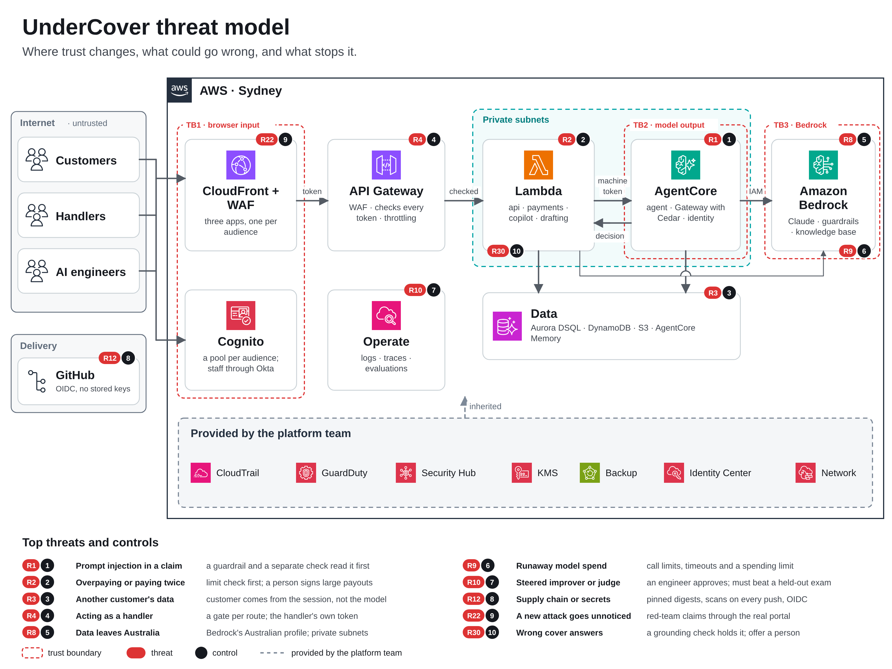
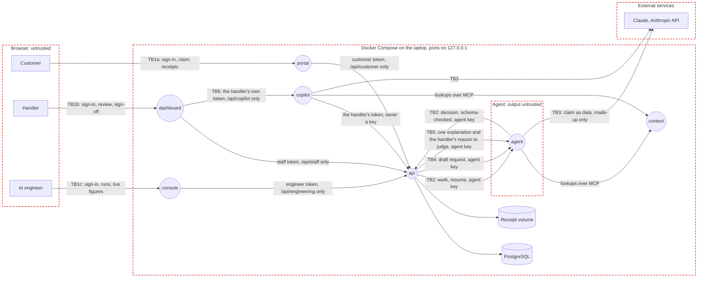

# Threat model

UnderCover on AWS, with made-up data; Docker runs the same apps locally for tests. STRIDE on the data flow below. OWASP lists: Top 10:2025 (A), API Security 2023 (API), LLM 2025 (LLM), Agentic 2026 (ASI).

## Data flow

The overview shows the AWS design with the top risks and their controls. The detail below is every flow and trust boundary (TB1a to TB6) that the risks cite.

Rectangles are external entities, circles processes, cylinders data stores, red dashed boxes trust boundaries. How each piece maps to AWS (Cognito, Aurora DSQL, Bedrock in Australia, AgentCore Gateway, private subnets) is in [the architecture guide](../guides/03-aws-architecture.md).

| ID | Data | Class | Where |
|:-:|------|-------|-------|
| D1 | Customers' names, contact, travel and medical details | Highly sensitive in production; made up here | PostgreSQL |
| D2 | Decisions, reasons, calculations and payments | Confidential | PostgreSQL |
| D3 | Policy wording, claims manual and other context files | Internal | The context layer |
| D4 | The labelled sets' handler decisions (the answer key), plus live claims an engineer added | Confidential | `data/evals/` and `labelled_claims`. No agent route returns one; the judge gets one reason at a time (TB5) |
| D5 | The Anthropic key, the agent's key and the sign-in signing keys | Secret | `.env` and memory, never logged. On AWS, AgentCore Identity's vault (client secrets also in Terraform state, trade-off 14) |
| D6 | Receipts customers upload | Highly sensitive in production; made up here | The receipt volume (S3 on AWS), random names |
| D7 | Customer feedback: a vote and up to 300 characters of text | Sensitive in production | `feedback`; engineers see it without a name; never sent to a model |
| D8 | Copilot conversations and each handler's preferences | Internal | `copilot` schema, per handler |
| D9 | Settings and their history: approval and spending limits, objectives | Confidential | `settings`, `setting_changes` |

## Trust boundaries

- **TB1a** Customers to the portal: the customer issuer (a Cognito pool on AWS). The portal forwards only `/api/customer/`; everything the browser sends is untrusted.
- **TB1b** Staff to the dashboard: a separate staff issuer, key and audience. The dashboard forwards only `/api/staff/`.
- **TB1c** AI engineers to the console: a third issuer; forwards only `/api/engineering/`. An engineer's one write to the evaluation set is insert-only and recorded (R29).
- **TB2** Agent and `api`: model output is untrusted. The `api` checks every decision against manual section 14 and the payout calculation before any payment.
- **TB3** App to Claude: claim text leaves the machine. Only made-up data is sent (spec 26); on Bedrock it stays in Australia.
- **TB4** The drafting assistant: its draft is untrusted, validated by the `api` and shown to the customer, who edits it and taps Send claim; it is never sent for them. The claim agent reads the customer's own words; on AWS a guardrail filters personal data from letters.
- **TB5** The judge: gets one pair of reasons at a time and returns a grade the `api` validates. The claim agent and improver never see the pairs (spec 24).
- **TB6** The Copilot: uses the handler's own token, never saved, and every tool is a staff route the `api` authorises again. Sign-off, send-back and dispatch wait on a confirm card (R11, R28).

## Top risks

STRIDE: Spoofing, Tampering, Repudiation, Information disclosure, Denial of service, Elevation of privilege.

| ID | Risk | STRIDE | OWASP | Rating | Controls |
|:-:|------|:-:|-------|:-:|----------|
| R1 | Instructions hidden in a claim make the agent approve or pay | T, E | LLM01, ASI01 | High | A hidden-instruction check on a separate model, plus on AWS a guardrail that fails closed, with receipts read as Textract fields. Content apart from instructions, limits in code (spec 20, 21); CLM-1901 test |
| R2 | The agent pays more than allowed, or twice | T, E | LLM06, ASI02 | High | The payments module checks the limit first and fails closed; sign-off over $1,000. One payment per claim, enforced by the database |
| R3 | The agent reads or acts on another customer's claim or memory | I, E | A01, API1, LLM02 | High | Tools take the claim and customer from the agent's context, not the model (spec 23). Abuse-case tests |
| R4 | The agent's key acts as a handler, or a handler signs off without the right | S, E | A01, API5 | High | One gate per route, deny by default; the key never stands in for a handler (spec 22). On AWS the agent uses its own machine token |
| R5 | The local sign-in stand-in runs outside the laptop | S | A07 | High | The `api` refuses to start with it unless `ENVIRONMENT=local`; tokens need `email_verified` |
| R6 | A decision can't be traced to who or what made it | R | A09 | Medium | Every decision records the maker, time and manual version (spec 25) |
| R7 | Personal data leaks into logs | I | A09, LLM02 | Medium | Redaction at the source through one formatter; SQL parameters hidden |
| R8 | Claim data goes to a model provider overseas | I | LLM02 | Medium | Made-up data only (spec 26). Bedrock's Australian profile with `MODEL_PROVIDER=bedrock` |
| R9 | Runaway model calls run up the bill | D | LLM10, API4 | Medium | Call limits and timeouts (code-standards 19), the workspace spend limit, a spending limit per round |
| R10 | A bad configuration from the improver *(planned)* | T, E | ASI07 | Medium | An engineer approves each proposal, kept or rolled back on the held-out set. The improver can't change limits, models or sets |
| R11 | The Copilot signs off without the handler | E | ASI02, ASI03 | Medium | It acts with the handler's own sign-in and pays only after a confirm card. Conversations are per handler |
| R12 | A compromised package or image | T | A03, LLM03 | Medium | Exact pins a week old, images by digest, Trivy on every push and PR |
| R13 | A secret is committed | I | A07 | Medium | `.env` ignored and kept out of images, the pre-push scan, OIDC with no long-lived keys |
| R14 | A customer reaches another's data, or a customer token reaches staff routes | I, E | A01, API1, API5 | High | Separate issuers per audience, so a customer token fails the signature on staff routes; every customer query filters on the signed-in customer. The demo's `TEST_SIGN_IN` lets anyone in as the made-up test customers; off outside the demo |
| R15 | A malicious receipt file attacks the app or a browser | T, E | A03, A08 | Medium | Type from magic bytes, 5 MB and five-file limits, random names. Served as attachments with `nosniff`, never on a public URL |
| R16 | Instructions hidden in a receipt make the agent pay | T, E | LLM01, ASI01 | High | The hidden-instruction check reads every receipt first; receipts delimited as customer data. Limits in code |
| R17 | The drafting assistant inflates amounts or slips in instructions | T | LLM01, LLM05, LLM09 | Medium | Schema with amount limits, confirmed by the customer; the submitted claim is still screened. The payout is worked out in code |
| R18 | A customer runs up model cost through drafts | D | LLM10, API4 | Low | Ten drafts an hour per customer, a token cap per draft, the spend limit |
| R19 | A senior handler's override pays without a record of why | R | A09 | Medium | A reason code and note are required, with who and when. Nothing already paid can change |
| R20 | A poisoned memory steers a later decision | T | ASI06, LLM04 | Medium | Memory holds only facts and decisions, never the customer's words, one namespace per customer. On AWS no extraction strategy, so no model writes memory |
| R21 | Money keeps leaving during an incident | T, E | LLM06, ASI02 | High | The payouts kill switch: a senior handler pauses every payment, failing closed and audited |
| R22 | A new attack slips past unnoticed | T | LLM01, ASI01 | Medium | The red-team suite runs attack claims end to end and must pay nothing beyond what each supports. On AWS it attacks the deployed defences |
| R23 | Retrying a stalled claim decides or pays it twice | T | LLM06, ASI02 | Medium | A compare-and-set on the heartbeat starts one retry; one decision per attempt, one payment per claim. Recovery capped at 2 a claim |
| R24 | A receipt steers a program the model writes to send data out or run up cost *(off: `CODE_EXECUTION`)* | I, D | LLM01, LLM05, ASI05 | High | Off by default, with nothing deployed. On, the sandbox reaches only VPC endpoints in private mode (keep it off with `NETWORK_MODE=public`), calls only the context gateway, and is capped in time and size |
| R25 | A dispatch runs up the bill or works a claim twice | D, T | LLM10, API4, ASI02 | Medium | Only a senior handler starts one, one at a time, at most 25 agents. Each claim starts by compare-and-set; the kill switch still holds |
| R26 | The judge is steered or leaks the answer key | T, I | LLM01, LLM02, ASI06 | Low | Its grade is shown only, never a gate, and validated against a schema. Pairs go only to `/judge`; the improver never sees held-out reasons |
| R27 | The approval limit is raised so the agent pays larger claims | E, T | LLM06, API5, ASI03 | Medium | Senior handlers only, within $100 to $5,000, every change on record. A held payout stays held |
| R28 | The Copilot is talked into a dispatch, a send-back or storing claim text | T, E | LLM01, LLM06, ASI02 | Medium | Each action waits on its own confirm card; the `api` enforces the role. Memory is per handler, 20 short notes, each save shown |
| R29 | A customer's story or feedback reaches the improver or engineers unsafely | T, I | LLM01, LLM04, ASI06 | Medium | Engineers add claims insert-only; flagged, evaluation and red-team claims are refused. Feedback is plain text, never sent to a model |
| R30 | Ask UnderCover contradicts the policy wording on cover | T | LLM09 | Medium | On AWS a grounding guardrail and Automated Reasoning hold back an unsupported answer and offer a person. Only a claim's decision says what's paid |
| R32 | A handler without sign-off rights pays a large claim by deciding a referral, or a reset wipes a live demo | E, T | LLM06, API5 | Medium | A referral's decision checks the payout against the approval limit for that handler and records the reason code, who and when; only a senior handler resets, only where the demo sign-in runs, never while the agent is on or a claim is being worked; the agent switch and each reset are recorded |
| R33 | Someone with database access rewrites an audit record (a switch's reason, an override) to cover a mistake | The audit log is a SHA-256 hash chain checked on every read, with an alert on a break (decision 57); on AWS each seal is also copied to write-once storage (S3 Object Lock, governance mode), and the newest is compared with its copy |
| R31 | A hidden instruction in a customer's message or receipt gets Wattle to change their PayID, send a claim or show another customer's claim | T, E, I | LLM01, LLM06 | High | Wattle has no tool that changes anything: it names one action from a fixed list, cards are filled from the customer's own records, a claim number that isn't theirs becomes their list, and only the customer's tap changes anything |

## Compliance

1. Only made-up data goes to a model (spec 26). Before real data: a privacy impact assessment, including the Privacy Act's automated-decision rules from 10 December 2026.
2. APRA CPS 234 and CPS 230 are designed in: controls tested yearly, APRA told within 72 hours of a material incident, breaches assessed within 30 days.
