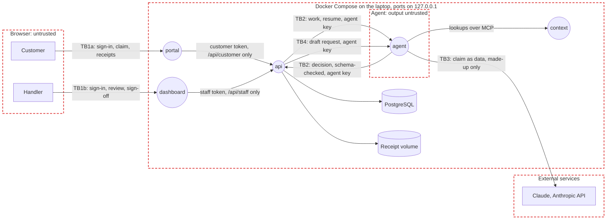

# Threat model

UnderCover in tier 1, on a laptop with made-up data; extended for AWS in tier 2. STRIDE on the data flow below; each risk maps to the OWASP lists that fit the app: Top 10:2025 (A), API Security Top 10:2023 (API), LLM Top 10:2025 (LLM) and Agentic Top 10:2026 (ASI).

## Data flow

Rectangles are external entities, circles processes, cylinders data stores, red dashed boxes trust boundaries; TB labels mark the flows that cross a boundary. In tier 2 the laptop becomes the AWS account in `ap-southeast-2` (serverless, decision 13), PostgreSQL moves to Supabase in Singapore (made-up data only, so nothing real leaves Australia; real data needs a database in Australia), sign-in moves to Amazon Cognito, and Claude moves to Bedrock's Australian inference profile.

| ID | Data | Class | Where |
|:-:|------|-------|-------|
| D1 | Customers' names, contact details, travel and medical details in claims | Highly sensitive in production; made up in tier 1 | PostgreSQL |
| D2 | Decisions, their reasons, calculations and payments | Confidential | PostgreSQL |
| D3 | Policy wording, claims manual and the other context files | Internal | The context layer, read by the agent |
| D4 | Handlers' decisions on the labelled sets: the answer key | Confidential | `data/evals/`, never loaded where the agent can reach it |
| D6 | Receipts: images and PDFs customers upload | Highly sensitive in production; made up in tier 1 | The receipt volume (an S3 bucket in tier 2), under random names |
| D5 | The Anthropic key, the agent's key and the two sign-in signing keys | Secret | `.env` and memory, never logged |

## Trust boundaries

- **TB1a** Customers to the portal: customers sign in through the customer issuer (a Cognito-shaped local stand-in; a Cognito user pool, email and password only, in tier 2, whose public test-account button signs anyone in as Oliver Grant, made-up data only). The portal's web server forwards only `/api/customer/`; everything the browser sends is untrusted, receipts included.
- **TB1b** Staff to the dashboard: handlers sign in through a separate staff issuer, with its own signing key and audience (a separate Cognito user pool in tier 2, reachable only from allowed networks). The dashboard's web server forwards only `/api/staff/`.
- **TB2** Agent and `api`: model output is untrusted; the `api` checks every decision against claims manual section 14 and the payout calculation before it can drive a payment.
- **TB3** App to Claude: claim text leaves the laptop. Tier 1 sends only made-up data (spec 26); tier 2 keeps it in Australia.
- **TB4** The drafting assistant: a customer's words and receipts go to Claude Haiku through the agent service, and its draft comes back to the customer's browser. The draft is untrusted model output: the `api` validates it, the customer confirms or fixes every field, it is never submitted for them, and the claim agent reads the customer's own words as the record (spec 10).

## Top risks

STRIDE: Spoofing, Tampering, Repudiation, Information disclosure, Denial of service, Elevation of privilege.

| ID | Risk | STRIDE | OWASP | Rating | Controls | Enforced at |
|:-:|------|:------:|-------|:------:|----------|-------------|
| R1 | Instructions hidden in a claim make the agent approve or pay it | T, E | LLM01, ASI01 | High | On AWS a Bedrock guardrail on the customer's text, failing closed, so an outage refers every claim (spec 36); the hidden-instruction check on a separate model before the claim agent sees the claim (spec 12), content kept apart from instructions (code-standards 18), limits in code (spec 20); CLM-1901 test | Code, Test |
| R2 | The agent pays more than allowed, or pays twice | T, E | LLM06, ASI02 | High | The payments module checks the limit before reading the claim and fails closed (code-standards 7); sign-off over $1,000 (spec 14); one payment per claim enforced by the database (spec 14) | Code, Test |
| R3 | The agent reads or acts on another customer's claim or memory | I, E | A01, API1, LLM02 | High | Tools take the claim and customer from the agent's context, not the model (spec 23); abuse-case tests (code-standards 11) | Code, Test |
| R4 | The agent's key acts as a handler, or a handler without the right signs off | S, E | A01, API5 | High | One gate per route, deny by default (code-standards 10); the key never stands in for a handler (spec 22); per-route tests | Code, Test |
| R5 | The local sign-in stand-in runs outside the laptop | S | A07 | High | The `api` refuses to start with it on unless `ENVIRONMENT=local`; tokens need `email_verified` | Code, Deploy |
| R6 | A decision can't be traced to who or what made it | R | A09 | Medium | The server records the maker, the time and the manual's version on every decision (spec 13) | Code |
| R7 | Personal data leaks into logs | I | A09, LLM02 | Medium | Redaction at the source, SQL parameters hidden, every logger through one formatter (code-standards 8, spec 25) | Code, Test |
| R8 | Claim data leaves for a model provider overseas | I | LLM02 | Medium | Made-up data only in tier 1 and in tier 2's `dev` on the Anthropic API (spec 26, decision 15); Bedrock's Australian profile in `prod`; the API key only in the app secret, an unfilled placeholder refused at start | Deploy, Code |
| R9 | Runaway model calls run up the bill | D | LLM10, API4 | Medium | Model call limits and timeouts (code-standards 19), the workspace's spend limit, each round's spending limit (spec 16) | Code, Operate |
| R10 | A bad configuration from the improver *(planned)* | T, E | ASI07 | Medium | An AI engineer approves every proposal; keep or roll back on the held-out set; the improver can't change limits, models or evaluation sets (spec 16) | Code, Test |
| R11 | The Copilot signs off without the handler | E | ASI02, ASI03 | Medium | It acts with the handler's own sign-in (never a service key; the token stays out of checkpoints) and pays only after the handler confirms on a card (spec 15, 22); conversations are each handler's own | Code, Test |
| R12 | A compromised package or image | T | A03, LLM03 | Medium | Exact pins resolved a week back, images pinned by digest, Trivy on every push and PR | Code, Build |
| R13 | A secret is committed | I | A07 | Medium | `.env` ignored and kept out of images, the pre-push scan, OIDC with no long-lived keys in tier 2 | Code, Deploy |
| R14 | A customer reaches another customer's claim, policy or receipt, or a customer token reaches handler routes | I, E | A01, API1, API5 | High | Separate apps and issuers for staff and customers (decision 10): `/api/staff/*` verifies only the staff issuer's key and audience, so a customer token fails the signature before any role check; each web server forwards only its own prefix; the Cognito group is checked too; every customer query filters on the signed-in customer; abuse-case tests on every route both ways (spec 21). In the tier 2 demo, `TEST_SIGN_IN` lets anyone sign in as the test customers, Oliver and the red team's Derek (made-up data only, each seeing only their own), and a sign-in resets that account's password, so a red-team run can be disturbed; it's off outside the demo | Code, Test, Deploy |
| R15 | A malicious receipt file attacks the app or a handler's browser | T, E | A03, A08 | Medium | Type from magic bytes (JPEG, PNG, PDF only), 5 MB and five-file limits, random stored names, downloads as attachments with `nosniff`, never on a public URL (spec 21) | Code, Test |
| R16 | Instructions hidden in a receipt make the agent approve or pay | T, E | LLM01, ASI01 | High | The hidden-instruction check reads every receipt before the claim agent (the Bedrock guardrail screens the claim's text only, not receipt images or PDFs); receipts delimited as customer-supplied data; limits in code (spec 12, 20) | Code, Test |
| R17 | The drafting assistant inflates amounts or slips instructions into the claim | T | LLM01, LLM05, LLM09 | Medium | The draft is validated against a schema with amount limits, tagged by source, highlighted where unsure and confirmed by the customer; the claim agent reads the customer's own words; the hidden-instruction check still screens the submitted claim and receipts; the payout is worked out in code from the policy | Code, Test |
| R18 | A customer runs up model costs through the drafting assistant | D | LLM10, API4 | Low | Ten drafts an hour per customer, a token cap per draft, the workspace spend limit | Code, Operate |
| R19 | A senior handler's override pays without a record of why | R | A09 | Medium | Override needs a reason code and note; the record keeps the agent's decision, who overrode it and when; nothing already paid can change | Code, Test |
| R20 | A poisoned memory: a customer's earlier claim steers a later decision | T | ASI06, LLM04 | Medium | Memory holds only the claim's facts and the agent's decision, never the customer's words; nothing from a claim the check referred or an evaluation; one namespace per customer; the claim history in the records still counts (spec 23) | Code, Test |
| R21 | Money keeps leaving during an incident | T, E | LLM06, ASI02 | High | The payouts kill switch: a senior handler pauses every payment, the payments module refuses first and fails closed, approvals hold, and every change is audited (spec 14) | Code, Operate |
| R22 | A new attack slips past the defences unnoticed | T | LLM01, ASI01 | Medium | The red-team suite (spec 16) runs attack claims end to end and must end with nothing paid beyond what each claim supports; the latest report is in the AI assurance console; on AWS the console starts it in the agent, signing in as its own attacker customer through Cognito, so it tests the deployed defences | Test |
| R23 | Retrying a stalled claim starts the same work twice, deciding or paying it twice | T | LLM06, ASI02 | Medium | A retry claims the stalled claim with a compare-and-set on its heartbeat, so only one retry starts; the agent refuses a claim it is already working; one decision per attempt and one payment per claim in the database (R2); automatic recovery capped at 2 a claim; the dev-only stall route only when `ENVIRONMENT=local` (R5) | Code, Test |

## Compliance

- Tier 1 sends only made-up data to the Anthropic API (spec 26). Before tier 2 uses real-looking data: a privacy impact assessment, including the Privacy Act's automated decision rules from 10 December 2026 (business 3).
- APRA CPS 234 and CPS 230 controls are designed in for tier 2: controls tested yearly, APRA told within 72 hours of a material security incident, suspected breaches assessed within 30 days.
